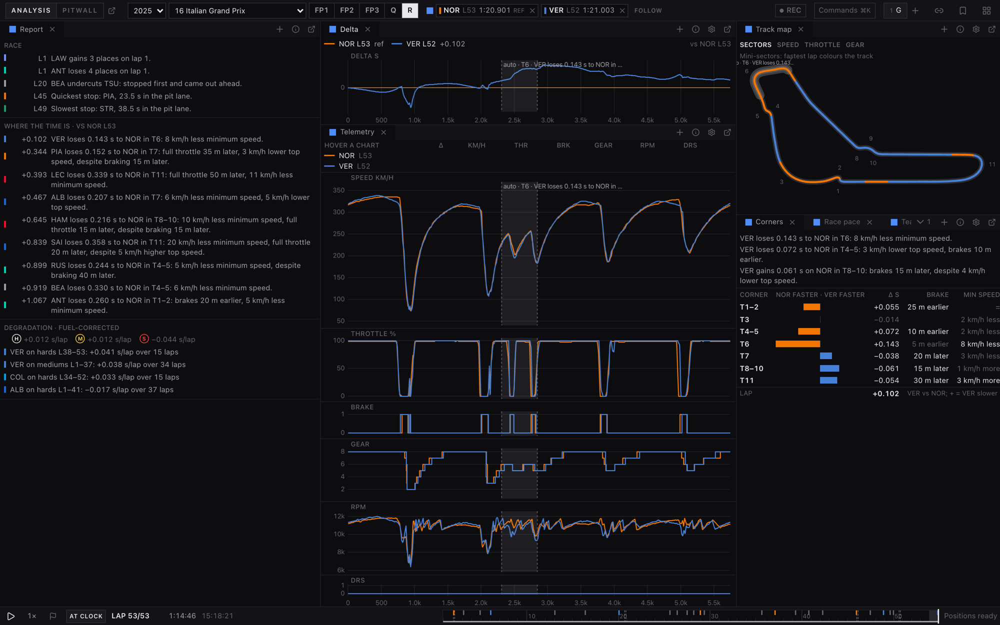

# F1 Pitwall

Een F1-analysedashboard in de stijl van een pitwall. Het vergelijkt laps tot op de bocht, speelt
een sessie af alsof hij live is, rekent strategie door op de sessieklok en neemt live sessies op.
Alles staat in dichte, zelf in te delen schermen met dertig+ widgets.


## Twee werkplekken

**Analyse**: na de sessie. Laps vergelijken, telemetrie over elkaar, waar de tijd zit per bocht,
mini-sectoren, energie-inzet (2026), long runs en een sessieverslag dat zelf de interessante dingen
vindt.

**Pitwall**: een bord dat speelt. De sessieklok onderin stuurt de tower, de kaart met alle auto's,
de Track line, race control en de strategie-widgets. Hetzelfde bord werkt in replay en live; de
panelen staan op slot, zodat er tijdens een sessie niets verschuift.

Beide werkplekken hebben eigen tabs met presets voor een laptop en een breed scherm, en elke
indeling is als eigen preset te bewaren. Met één klik open je de andere werkplek in een tweede
venster (bijvoorbeeld op een tweede scherm).

| | |
|---|---|
|  |  |
| **Engineer** (Analyse): Monza 2025 Q, VER tegen NOR. Delta, telemetrie, de kaart in mini-sectoren en per bocht waarom NOR 0,141 s verliest in T1–2. | **Debrief** (Analyse): het sessieverslag. Race-momenten, waar de tijd zit tegen de winnaar en degradatie per band. Klik op een regel en de charts zoomen erheen. |
|  |  |
| **Strategy** (Pitwall): stints, wat een safety car nu zou doen, gevechten met trend en inhaalmoment, race pace met degradatie-fits en het pit window met undercut/overcut. | **Qualifying board** (Pitwall): tower met Q-cut en voorspelde laptijd, de lap die bezig is tegen de beste, en Release: wanneer een auto de pit uit kan met vrije baan. |

## Features

### Lap-analyse
- **Telemetry**: speed, throttle, brake, gear, RPM en DRS van meerdere laps over elkaar, met een
  gedeelde cursor en zoom. De delta wordt zelf berekend op een grid van 5 m, zodat hij aan de finish
  precies het verschil in laptijd is.
- **Corners**: per bocht het verschil, met zinnen als *"NOR loses 0.141 s to VER in T1–2: brakes
  10 m earlier"*. Ook **Corner phases** (remmen, rollen, gas per bocht) en **Corners live**.
- **Mini-sectors**, **Bests** (theoretische beste lap), **Speed traps**, **Speed map** (topsnelheid
  tegen bochtsnelheid: downforce of weinig weerstand) en **Teammates**.
- **Track map**, te kleuren op sectoren, snelheid, gas of versnelling, met bochtnummers, sectoren
  en zones.

### Replay en Pitwall
- Eén **sessieklok** voor alles: afspelen, scrubben, snelheid, met track status en laps op de balk.
- **Timing tower** zoals de officiële: gaps per timingpunt, paars/groen zoals het toen was, Q-cut en
  voorspelde laptijd in kwalificatie.
- **Kaart met alle auto's** (posities op 4 Hz), **Track line**, gele sectoren, **Live lap** en
  **Live delta** (de lap die bezig is tegen de vorige of de beste), en een digitale **Clock**.
- **Meldingen**: snelste lap, gat onder 1 s, tempo-omslag, deleted laps, straffen, inhaalacties.
  Ook **team radio**, die vanzelf afspeelt als de klok erlangs komt.

### Strategie
- **Stints**, **Gaps**, **Positions** (lap chart vanaf de grid), **Race pace**
  (brandstofgecorrigeerd, degradatie-fit per stint).
- **Pit window**: pit nu, waar kom je terug, en undercut/overcut op de auto ervoor en erachter.
  Pitverlies-ghosts op de kaart laten zien waar je terugkomt.
- **Safety car**: wat een stop onder SC/VSC nu oplevert. **Forecast**: de uitslag als iedereen
  doorrijdt (met de stop die nog moet).
- **Battles**, **Passes**, **Starts** (posities tot 500 m, ook herstarts na rood), **Stewards**
  (deleted laps, onderzoeken en straffen uit race control) en **Tyre sets** over het weekend.

### 2026-regels
- **Energie**: er is geen kanaal voor de batterij, dus een schatting uit de versnelling bij vol gas.
  Waar een auto clipt, superclipt (snelheid verliest bij vol gas) en wat dat kost, plus
  terugschakelen op de straight.
- **Straight mode** (de opvolger van DRS): de zones uit de circuitkaart van de FIA, op de kaart en
  in de charts, ook bij weinig grip.
- **Overtake mode**: detectie- en activatielijn, en wie binnen 1 s zit.

### Sessieverslag en markeringen
- **Report** vindt zelf wat telt: race-momenten (start, undercuts, snelste en traagste stop,
  tempo-omslagen), waar de tijd zit, long runs, degradatie en clipping. Elke regel is klikbaar.
- **Markeringen** (afstand of moment, met notitie en tags) in alle charts, op de kaart en op de
  klokbalk. Wat Report vindt verschijnt vanzelf als automatische markering.
- **Views**: sessie, laps, zoom, klok en indeling als bladwijzer, of als deelbare link.

### Live
- Een **recorder** neemt de live-feed van F1 op (met een eigen F1 TV-login). Elke paar seconden
  wordt de opname omgezet naar hetzelfde formaat als het archief, dus elke widget werkt live
  zonder aanpassingen, en na afloop is de opname gewoon een replay.
- Starten kan vanuit de topbalk (REC), ook wachtend op de volgende sessie.

### Bediening
- **⌘K**-palette met alle acties. Sneltoetsen voor laps stappen, markeren, de klok (Space, ← →),
  tabs (1–9) en wisselen van werkplek (`w`).
- **Link-groepen**: panelen met dezelfde kleur volgen dezelfde laps. Twee vergelijkingen naast
  elkaar kunnen dus ook.
- Elk paneel heeft instellingen (tandwiel) en een uitleg (i): wat je ziet en waar je op moet letten.

## Architectuur

```
backend/    Python 3.12 · FastAPI · FastF1 · numpy      JSON-API op :8000
frontend/   Vite · React 19 · TypeScript · Tailwind 4    SPA op :5173
            dockview (docking) · uPlot (charts) · TanStack Query · Zustand
```

- De **backend** doet het zware werk: data ophalen en cachen, telemetrie resamplen, delta's, de
  tower op tijd t, het positiespoor van een hele sessie, strategie- en energiemodellen. Het
  rekenwerk zit in pure functies met tests.
- De **frontend** is een client-side dashboard. Telemetrie gaat kolomgewijs over de lijn en direct
  naar uPlot, en de klok en cursor lopen buiten React om, zodat afspelen met 22 auto's niet hapert.
- Geen database-server en geen containers: bronbestanden worden gzipped gecachet in
  `backend/.cache/`, markeringen en views staan in SQLite (`backend/data/f1dash.db`).
- De TypeScript-types worden gegenereerd uit de OpenAPI van de backend (`make gen-api`).

### Databronnen

| Bron | Gebruikt voor |
|---|---|
| [TracingInsights](https://github.com/TracingInsights) | Archief 2018–2026: laps, telemetrie, posities, weer, race control, team radio (gemaakt met FastF1) |
| Eigen live-opnames | Sessies vanaf Austin 2026, opgenomen met FastF1's live client |
| [FastF1](https://docs.fastf1.dev) | Kalender, live client, omzetten van de live-feed |
| [Jolpica](https://github.com/jolpica/jolpica-f1) | Startgrid |
| FIA-documenten | Straight-mode-zones en overtake-lijnen per circuit (2026) |

Sinds oktober 2026 staat het archief van F1 zelf achter een login. Daarom zijn TracingInsights en
de eigen opnames de bronnen.

## Starten

Vereist: [uv](https://docs.astral.sh/uv/) (`brew install uv`) en Node 20+.

```bash
make install
make dev        # API op :8000, dashboard op http://localhost:5173
```

Een sessie die je voor het eerst opent wordt eenmalig gedownload. Daarna komt hij uit de cache.

### Live opnemen

```bash
cd backend && uv run python -m fastf1 auth f1tv --authenticate   # eenmalig, F1 TV-account nodig
make live                                                          # of REC in de topbalk
```

## Ontwikkelen

| Commando | |
|---|---|
| `make check` | ruff, pytest, oxlint, typecheck en build |
| `make gen-api` | TypeScript-types opnieuw genereren na een wijziging in de API |
| `cd backend && F1DASH_LIVE=/tmp/f1live uv run python -m app.live.simulate 2025 16 R` | een archiefsessie afspelen als live-feed, om te testen zonder live sessie (in een aparte map, niet tussen de echte opnames) |

`ROADMAP.md` bevat de fases en de status. `CLAUDE.md` beschrijft de modellen, de conventies en de
valkuilen in de data.

---

Een hobbyproject, niet verbonden aan Formula 1, de FIA of een team. F1, Formula 1 en gerelateerde
namen zijn handelsmerken van Formula One Licensing B.V.
