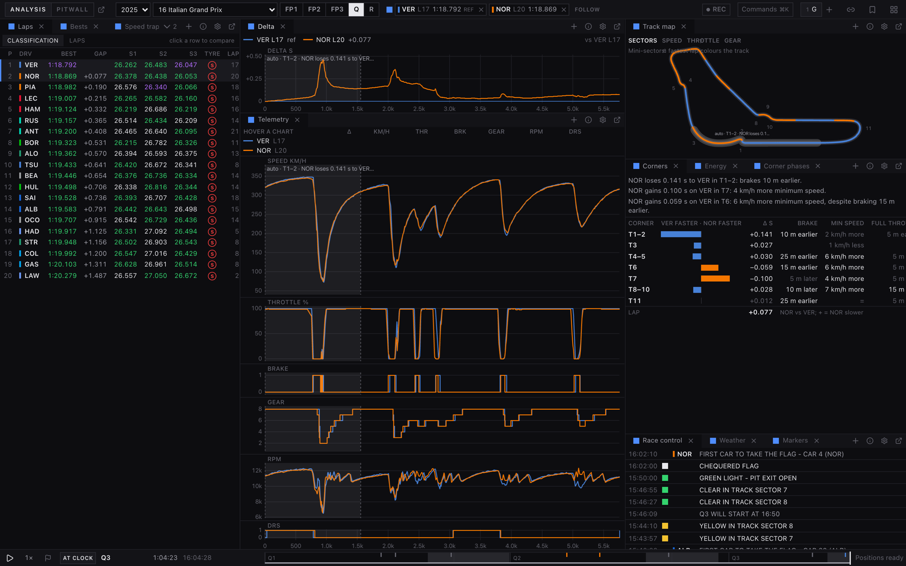
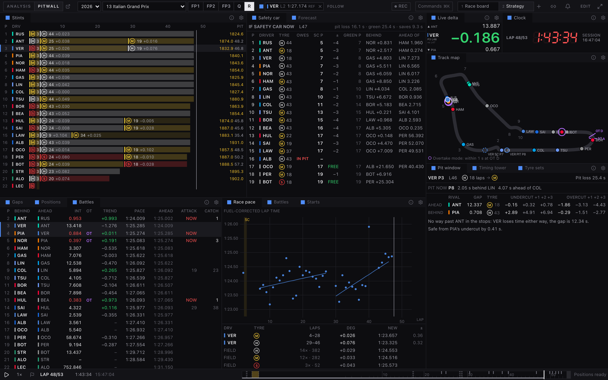
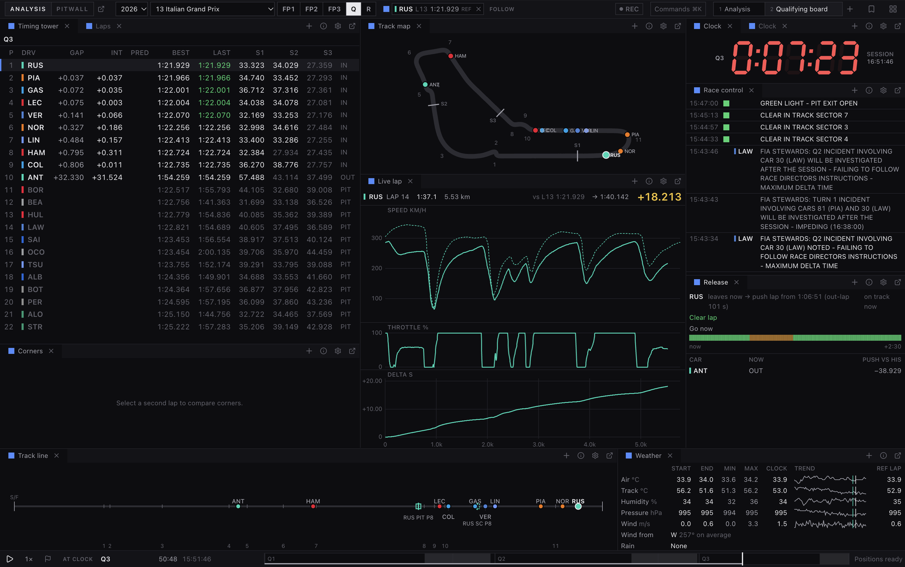

# F1 Pitwall

An F1 analysis dashboard in the style of pitwall software. It compares laps corner by corner,
replays a session as if it were live, works out strategy on the session clock and records live
sessions. Everything sits in dense, rearrangeable screens built from more than thirty widgets.


## Two workspaces

**Analysis** is for after the session: compare laps, overlay telemetry, see where the time goes
in each corner, mini-sectors, energy deployment (2026), long runs, and a session report that finds
the interesting parts on its own.

**Pitwall** is a board that plays. The session clock at the bottom drives the timing tower, the
map with every car, the track line, race control and the strategy widgets. The same board works
in replay and live, and its panels are locked so nothing moves during a session.

Each workspace has its own tabs, with presets for a laptop and for a wide screen, and you can
save any layout as your own preset. One click opens the other workspace in a separate window, for
example on a second screen.

| | |
|---|---|
|  |  |
| **Engineer** (Analysis): Monza 2025 Q, VER against NOR. Delta, telemetry, the map in mini-sectors, and why NOR loses 0.141 s in T1–2. | **Debrief** (Analysis): the session report. Race moments, where the time goes against the winner, and degradation per compound. Click a line and the charts zoom to it. |
|  |  |
| **Strategy** (Pitwall): stints, what a safety car would do right now, battles with their trend and when the gap closes, race pace with degradation fits, and the pit window with undercut and overcut. | **Qualifying board** (Pitwall): the tower with the Q cut-off and predicted lap times, the lap in progress against the best, and Release: when a car can leave the pits into clear track. |

## Features

### Lap analysis
- **Telemetry**: speed, throttle, brake, gear, RPM and DRS for several laps overlaid, with a
  shared cursor and zoom. The delta is computed on a 5 m grid, so at the line it is exactly the
  lap-time difference.
- **Corners**: the difference per corner, explained in sentences such as *"NOR loses 0.141 s to
  VER in T1–2: brakes 10 m earlier"*. Also **Corner phases** (braking, coasting and throttle per
  corner) and **Corners live**.
- **Mini-sectors** for the whole field, as on the official timing screens: a block per
  mini-sector, purple, green or yellow, filling up as the lap is driven.
- **Bests** (theoretical best lap), **Speed traps**, **Speed map** (top speed
  against cornering speed: downforce or low drag) and **Teammates**.
- **Track map**, coloured by sector, speed, throttle or gear, with corner numbers, sectors and
  zones.

### Replay and Pitwall
- One **session clock** for everything: play, scrub and change speed, with track status and laps
  on the bar.
- A **timing tower** like the official one: gaps at every timing point, purple and green as they
  were at that moment, and the cut-off and predicted lap times in qualifying.
- **Every car on the map** (positions at 4 Hz), the **track line**, yellow sectors, **Live lap**
  and **Live delta** (the lap in progress against the previous or the best one, with the gaps
  ahead and behind, laid out to fit any panel), and a digital **Clock**.
- **Alerts**: fastest lap, a gap under 1 s, pace changes, deleted laps, penalties and overtakes.
  **Team radio** plays by itself as the clock passes each message.

### Strategy
- **Stints**, **Gaps**, **Positions** (lap chart from the grid) and **Race pace** (fuel-corrected,
  with a degradation fit per stint).
- **Pit window**: pit now, where you rejoin, and the undercut or overcut on the cars ahead and
  behind. Pit-loss ghosts on the map show where you would come out.
- **Safety car**: what a stop under SC or VSC gains right now. **Forecast**: the result if
  everyone keeps going, including the stops still owed.
- **Battles**, **Passes**, **Starts** (positions up to 500 m, restarts after a red flag included),
  **Stewards** (deleted laps, investigations and penalties from race control) and **Tyre sets**
  across the weekend.

### 2026 regulations
- **Energy**: there is no battery channel in the data, so this is an estimate from the
  acceleration at full throttle. It shows where a car clips, where it superclips (loses speed at
  full throttle) and what that costs, plus downshifts on the straights.
- **Straight mode** (the successor to DRS): the zones from the FIA circuit map, on the map and in
  the charts, including low-grip conditions.
- **Overtake mode**: the detection and activation lines, and who is within 1 s.

### Session report and markers
- **Report** finds what matters: race moments (start, undercuts, fastest and slowest stop, pace
  changes), where the time goes, long runs, degradation and clipping. Every line is clickable.
- **Markers** (a distance or a moment, with a note and tags) appear in every chart, on the map and
  on the clock bar. What Report finds shows up as automatic markers.
- **Views** save the session, laps, zoom, clock and layout as a bookmark or a shareable link.

### Live
- A **recorder** captures F1's live timing feed (with your own F1 TV login). Every few seconds the
  recording is converted to the same format as the archive, so every widget works live without
  changes, and afterwards the recording is simply a replay.
- Start it from the top bar (REC), or let it wait for the next session.

### Controls
- A **⌘K** palette with every action. Shortcuts for stepping through laps, markers, the clock
  (Space, ← →), tabs (1–9) and switching workspace (`w`).
- **Link groups**: panels with the same colour follow the same laps, so two comparisons can sit
  side by side.
- Every panel has settings (the gear) and an explanation (i) of what it shows and what to look
  for.

## Architecture

```
backend/    Python 3.12 · FastAPI · FastF1 · numpy      JSON API on :8000
frontend/   Vite · React 19 · TypeScript · Tailwind 4    SPA on :5173
            dockview (docking) · uPlot (charts) · TanStack Query · Zustand
```

- The **backend** does the heavy lifting: fetching and caching data, resampling telemetry,
  deltas, the tower at time t, the position track of a whole session, and the strategy and energy
  models. The calculations are pure functions with tests.
- The **frontend** is a client-side dashboard. Telemetry is sent column by column and goes
  straight into uPlot. The clock and cursor run outside React, so playback with 22 cars stays
  smooth.
- There is no database server and there are no containers. Source files are cached gzipped in
  `backend/.cache/`, and markers and views live in SQLite (`backend/data/f1dash.db`).
- TypeScript types are generated from the backend's OpenAPI schema (`make gen-api`).

### Data sources

| Source | Used for |
|---|---|
| [TracingInsights](https://github.com/TracingInsights) | Archive 2018–2026: laps, telemetry, positions, weather, race control, team radio (built with FastF1) |
| Own live recordings | Sessions from Austin 2026 onwards, recorded with FastF1's live client |
| [FastF1](https://docs.fastf1.dev) | Calendar, live client, converting the live feed |
| [Jolpica](https://github.com/jolpica/jolpica-f1) | Starting grid |
| FIA documents | Straight-mode zones and overtake lines per circuit (2026) |

Since October 2026, F1's own timing archive requires a login. That is why TracingInsights and the
recordings are the sources.

## Getting started

Requires [uv](https://docs.astral.sh/uv/) (`brew install uv`) and Node 20+.

```bash
make install
make dev        # API on :8000, dashboard on http://localhost:5173
```

The first time you open a session it is downloaded once. After that it comes from the cache.

`make install` also installs Whisper for team radio as text (MLX on Apple silicon). The first
TRANSCRIBE downloads the model once (~1.6 GB). Without it: `cd backend && uv sync`.

### Recording live

```bash
cd backend && uv run python -m fastf1 auth f1tv --authenticate   # once, needs an F1 TV account
make live                                                          # or REC in the top bar
```

## Development

| Command | |
|---|---|
| `make check` | ruff, pytest, oxlint, typecheck and build |
| `make gen-api` | regenerate the TypeScript types after an API change |
| `cd backend && F1DASH_LIVE=/tmp/f1live uv run python -m app.live.simulate 2025 16 R` | play an archived session as a live feed, for testing without a live session (in a separate folder, away from real recordings) |

`ROADMAP.md` has the phases and their status. `CLAUDE.md` describes the models, the conventions
and the pitfalls in the data. Both are in Dutch.

---

MIT licensed, see `LICENSE`. The data comes from its sources under their own terms.

A hobby project, not affiliated with Formula 1, the FIA or any team. F1, Formula 1 and related
marks are trademarks of Formula One Licensing B.V.
