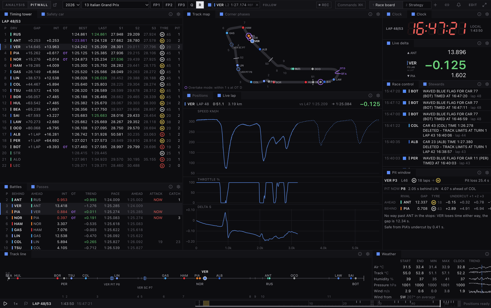
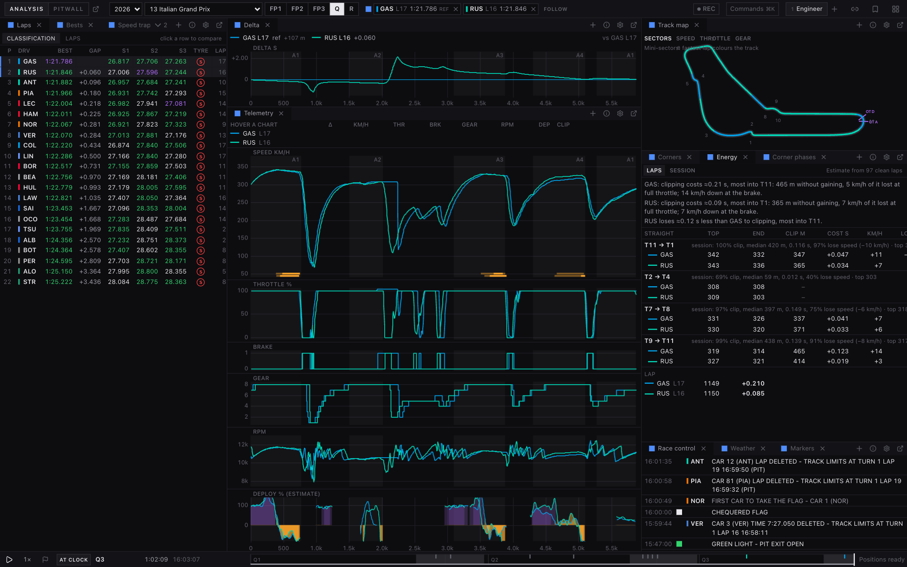
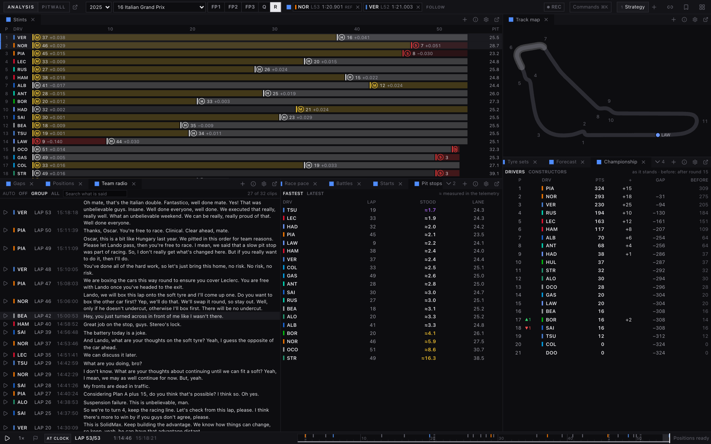

# Undercut – Pitwall application

[](https://github.com/NilasMeeder/Undercut/actions/workflows/ci.yml)
[](LICENSE)

> **A hobby project.** Undercut is unofficial and not affiliated with Formula 1, the FIA or any
> team. I built it in my spare time to dig into timing data the way a pitwall would. It runs on
> your own computer; there is no hosted version. See [Disclaimer](#disclaimer).

An F1 analysis dashboard in the style of pitwall software. It compares laps corner by corner,
replays a session as if it were live, works out strategy on the session clock and records live
sessions. Everything sits in dense, rearrangeable screens built from more than thirty widgets.



**Contents:** [Two workspaces](#two-workspaces) · [Features](#features) ·
[How it works, and what is estimated](#how-it-works-and-what-is-estimated) ·
[Architecture](#architecture) · [Getting started](#getting-started) ·
[Development](#development) · [Disclaimer](#disclaimer)

## Two workspaces

**Analysis** is for after the session: compare laps, overlay telemetry, see where the time goes
in each corner, mini-sectors, energy deployment (2026), long runs, and a session report that finds
the interesting parts on its own.

**Pitwall** is a board that plays. The session clock at the bottom drives the timing tower, the
map with every car, the track line, race control and the strategy widgets. The same board works
in replay and live, and its panels are locked so nothing moves during a session.

Each workspace has its own tabs, with presets for a laptop and for a wide screen, and you can
save any layout as your own preset. One click opens the other workspace in a separate window, for
example on a second screen.

| | |
|---|---|
|  |  |
| **Engineer** (Analysis): Monza 2025 Q, VER against NOR. Delta, telemetry, the map in mini-sectors, and why NOR loses 0.141 s in T1–2. | **Debrief** (Analysis): the session report. Race moments, where the time goes against the winner, and degradation per compound. Click a line and the charts zoom to it. |
|  |  |
| **Strategy** (Pitwall): stints, what a safety car would do right now, battles with their trend and when the gap closes, race pace with degradation fits, and the pit window with undercut and overcut. | **Qualifying board** (Pitwall): the tower with the Q cut-off and predicted lap times, the lap in progress against the best, and Release: when a car can leave the pits into clear track. |
|  |  |
| **Energy** (Analysis): Monza 2026 Q, GAS against RUS. Where each car clips per straight and what it costs (GAS ≈0.21 s, most into T11), with the estimated deploy channel under the telemetry. | **After the flag** (Analysis): Monza 2025 R. Team radio as text, McLaren's team orders included, how long each car stood in its box (NOR's slow stop: ≈5.9 s), and the championship as it stands. |

## Features

### Lap analysis
- **Telemetry**: speed, throttle, brake, gear, RPM and DRS for several laps overlaid, with a
  shared cursor and zoom. The delta is computed on a 5 m grid, so at the line it is exactly the
  lap-time difference.
- **Corners**: the difference per corner, explained in sentences such as *"NOR loses 0.141 s to
  VER in T1–2: brakes 10 m earlier"*. Also **Corner phases** (braking, coasting and throttle per
  corner) and **Corners live**.
- **Mini-sectors** for the whole field, as on the official timing screens: a block per
  mini-sector, purple, green or yellow, filling up as the lap is driven.
- **Bests** (theoretical best lap), **Speed traps**, **Speed map** (top speed
  against cornering speed: downforce or low drag) and **Teammates**.
- **Track map**, coloured by sector, speed, throttle or gear, with corner numbers, sectors and
  zones.

### Replay and Pitwall
- One **session clock** for everything: play, scrub and change speed, with track status and laps
  on the bar.
- A **timing tower** like the official one: gaps at every timing point, purple and green as they
  were at that moment, and the cut-off and predicted lap times in qualifying.
- **Every car on the map** (positions at 4 Hz), the **track line**, yellow sectors, **Live lap**
  and **Live delta** (the lap in progress against the previous or the best one, with the gaps
  ahead and behind, laid out to fit any panel), and a digital **Clock**.
- **Alerts**: fastest lap, a gap under 1 s, pace changes, deleted laps, penalties and overtakes.

### Strategy
- **Stints**, **Gaps**, **Positions** (lap chart from the grid) and **Race pace** (fuel-corrected,
  with a degradation fit per stint).
- **Pit window**: pit now, where you rejoin, and the undercut or overcut on the cars ahead and
  behind. Pit-loss ghosts on the map show where you would come out.
- **Safety car**: what a stop under SC or VSC gains right now. **Forecast**: the result if
  everyone keeps going, including the stops still owed.
- **Championship**: the drivers' and constructors' standings as they would be if the race ended
  now.
- **Pit stops**: how long each car stood in its box, fastest first or latest first.
- **Battles**, **Passes**, **Starts** (positions up to 500 m, restarts after a red flag included),
  **Stewards** (deleted laps, investigations and penalties from race control) and **Tyre sets**
  across the weekend.

### Team radio
- **Team radio** plays by itself as the clock passes each message, for the drivers you follow or
  for everyone.
- **As text**: every clip is transcribed on your own computer with Whisper, so you can read along
  and search for what was said. No audio leaves your machine.

### 2026 regulations
- **Energy**: an estimate of where a car runs out of electric deployment (clipping), where it
  loses speed at full throttle (superclipping) and what that costs, plus downshifts on the
  straights. How it works is [explained below](#energy-and-clipping-2026).
- **Straight mode** (the successor to DRS): the zones from the FIA circuit map, on the map and in
  the charts, including low-grip conditions.
- **Overtake mode**: the detection and activation lines, and who is within 1 s.

### Session report and markers
- **Report** finds what matters: race moments (start, undercuts, fastest and slowest stop, pace
  changes), where the time goes, long runs, degradation and clipping. Every line is clickable.
- **Markers** (a distance or a moment, with a note and tags) appear in every chart, on the map and
  on the clock bar. What Report finds shows up as automatic markers.
- **Views** save the session, laps, zoom, clock and layout as a bookmark or a shareable link.

### Live
- A **recorder** captures F1's live timing feed (with your own F1 TV login). Every few seconds the
  recording is converted to the same format as the archive, so every widget works live without
  changes, and afterwards the recording is simply a replay.
- Start it from the top bar (REC), let it wait for the next session, or let it **record every
  session automatically** (it keeps the Mac awake while it records). The REC menu shows whether
  the feed is still coming in, how far behind it runs and when your sign-in expires.
- **F1's archive** (experimental): a session that is not in the archive below can be downloaded
  from F1's own timing archive with the same F1 TV sign-in.

### Controls
- A **⌘K** palette with every action. Shortcuts for stepping through laps, markers, the clock
  (Space, ← →), tabs (1–9) and switching workspace (`w`).
- **Link groups**: panels with the same colour follow the same laps, so two comparisons can sit
  side by side.
- Every panel has settings (the gear) and an explanation (i) of what it shows and what to look
  for.

## How it works, and what is estimated

F1's public data is thin: car data and positions come in at about 4 Hz, brake is on or off (no
pressure), and since 2026 there is no channel for the battery or the wings at all. Some numbers
in Undercut are therefore measured and some are modelled. The app marks estimates with `≈` or
says so in the panel's (i), and this section explains the models.

### Delta
Each lap is stretched to the length of the reference lap (racing lines differ by a few metres),
resampled on a 5 m grid and the time interpolated. The delta at the line is then exactly the
lap-time difference. FastF1's own `delta_time` is not used because it drifts. Braking points on
4 Hz data are good to about 10–20 m, so Corners does not name differences under 10 m or 3 km/h as
a cause.

### Energy and clipping (2026)
There is no battery or MGU-K channel in the data, so energy is an **estimate from the speed
trace**. The idea: at full throttle a car accelerates as hard as its power allows, and with the
MGU-K deploying that is much more than the engine alone (at Monza 2026 around 9 against
3.5 m/s² at 230 km/h).

1. **Acceleration** comes from the speed itself (a straight-line fit over ±0.5 s), corrected for
   gradient from the height data, so a climb is not mistaken for clipping.
2. **Straights** are stretches at full throttle of at least 250 m. Fast corners taken flat are
   left out, because there grip and drag decide the speed, not the battery.
3. **The envelope**: per straight, the 95th percentile of acceleration at each speed over all
   clean laps of the session. That is what a car on full deployment can do there.
4. **Clipping** is where a car itself stops gaining speed at full throttle while the envelope says
   it could still gain at least 1 m/s², or where it loses at least 3 km/h. **Superclipping** is
   losing speed with the throttle still flat (the MGU-K harvesting).
5. **The cost**: a car that kept following the envelope from the clipping point to the brakes,
   compared with the lap as driven. It counts only when that is worth at least 3 km/h.
6. **Deploy %** in Telemetry: the acceleration as a share of the envelope. Purple where the lap
   clearly gains more than the engine alone could, amber where it clips or harvests.

What it cannot know: slipstream and (in races) overtake mode end up in the envelope, so in a race
everyone appears to clip a little more; a weaker engine and less deployment look the same; and the
clipping point can start up to ~40 m late. Read it as *where and roughly how much*, not as the
team's own numbers.

### Strategy
- **Fuel correction**: 0.03 s per kg by default (adjustable), with 100 kg spread over the race
  distance. Without it, race stints seem to get faster.
- **Degradation**: a linear fit of fuel-corrected lap time against tyre age per stint, on clean
  laps only (no pit laps, no lap 1, no SC/VSC/red, outliers removed).
- **Pit loss** per stop: in-lap plus out-lap minus twice the median clean lap around it.
- **Undercut and overcut**: the old tyre follows its own stint fit, the new tyre the field's fit
  for that compound plus the driver's own pace offset. Pit loss cancels out between the two cars.
- **Forecast** extends every car's lap times with the same tyre model to the flag. A sudden change
  of pace is not carried forward: tested over all races of 2025–2026, it made the forecast worse.

### Other estimates
- **Mini-sectors** for the whole field and **overtake mode** (who was within 1 s at the detection
  line) come from the 4 Hz position track, not from F1's timing loops: a few hundredths of a second
  uncertain. Live, the tower uses F1's own mini-sectors.
- **Pit stop times** are F1's own when the session was recorded live; otherwise they are measured
  in the telemetry as the time below 1.5 km/h (shown with `≈`).
- **Championship** uses the order on track, so time penalties are not applied.
- **The session clock** in qualifying and practice is recomputed for archived sessions and can be
  a few seconds off; live it is F1's own clock.
- **Track evolution** in qualifying fits each push lap as driver + tyre + track over time;
  anything that makes everyone faster (including more risk in Q3) counts as track.
- **Team radio text** is Whisper's best guess and can mishear names or garbled audio.

## Architecture

```
backend/    Python 3.12 · FastAPI · FastF1 · numpy      JSON API on :8000
frontend/   Vite · React 19 · TypeScript · Tailwind 4    SPA on :5173
            dockview (docking) · uPlot (charts) · TanStack Query · Zustand
```

- The **backend** does the heavy lifting: fetching and caching data, resampling telemetry,
  deltas, the tower at time t, the position track of a whole session, and the strategy and energy
  models. The calculations are pure functions with tests.
- The **frontend** is a client-side dashboard. Telemetry is sent column by column and goes
  straight into uPlot. The clock and cursor run outside React, so playback with 22 cars stays
  smooth.
- There is no database server and there are no containers. Source files are cached gzipped in
  `backend/.cache/`, and markers and views live in SQLite (`backend/data/f1dash.db`).
- The API only listens on localhost and only accepts requests from pages on localhost.
- TypeScript types are generated from the backend's OpenAPI schema (`make gen-api`).

### Data sources

| Source | Used for |
|---|---|
| [TracingInsights](https://github.com/TracingInsights) | Archive 2018–2026: laps, telemetry, positions, weather, race control, team radio (built with FastF1) |
| Own live recordings | Sessions from Austin 2026 onwards, recorded with FastF1's live client |
| [FastF1](https://docs.fastf1.dev) | Calendar, live client, converting the live feed |
| [Jolpica](https://github.com/jolpica/jolpica-f1) | Starting grid, championship standings |
| FIA documents | Straight-mode zones and overtake lines per circuit (2026) |

Since October 2026, F1's own timing archive requires a login. That is why TracingInsights and the
recordings are the sources. None of this data is stored in the repository; it is downloaded when
you open a session and cached on your own computer.

## Getting started

Requires [uv](https://docs.astral.sh/uv/) (`brew install uv`) and Node 20+. Developed and used on
macOS (Apple silicon); other platforms are untested.

```bash
make install
make dev        # API on :8000, dashboard on http://localhost:5173
```

The first time you open a session it is downloaded once. After that it comes from the cache.

`make install` also installs Whisper for team radio as text (MLX on Apple silicon). The first
TRANSCRIBE downloads the model once (~1.6 GB). Without it: `cd backend && uv sync`.

### Recording live

```bash
cd backend && uv run python -m fastf1 auth f1tv --authenticate   # once, needs an F1 TV account
make live                                                          # or REC in the top bar
```

## Development

| Command | |
|---|---|
| `make check` | ruff, pytest, oxlint, typecheck and build |
| `make gen-api` | regenerate the TypeScript types after an API change |
| `cd backend && F1DASH_LIVE=/tmp/f1live uv run python -m app.live.simulate 2025 16 R` | play an archived session as a live feed, for testing without a live session (in a separate folder, away from real recordings) |

`ROADMAP.md` has the phases and their status. `CLAUDE.md` describes the models, the conventions
and the pitfalls in the data. Both are in Dutch.

This is a hobby project: it is built for my own use, changes when I feel like it and comes without
any guarantee or support.

## Disclaimer

Undercut is an unofficial hobby project. It is not associated in any way with the Formula 1
companies, the FIA or any team. F1, FORMULA ONE, FORMULA 1, FIA FORMULA ONE WORLD CHAMPIONSHIP,
GRAND PRIX and related marks are trademarks of Formula One Licensing B.V.

- The app uses no official logos, fonts or imagery. Team colours and three-letter driver codes
  are only there to tell the cars apart.
- The repository contains no timing data, telemetry, audio or recordings. Everything is fetched
  from the sources above, under their own terms, and stays on your own computer.
- Live recording and F1's archive need your own F1 TV subscription and are meant for personal use;
  check F1 TV's terms yourself. Your sign-in stays on your computer and is only sent to
  livetiming.formula1.com.
- Team radio audio belongs to its rights holders. The app plays it from the source and transcribes
  it locally; transcripts are not shared.
- The screenshots show the 2025 and 2026 Italian Grand Prix, for illustration.

The code is MIT licensed, see [`LICENSE`](LICENSE). The licence covers the code only, not the data
it reads.
